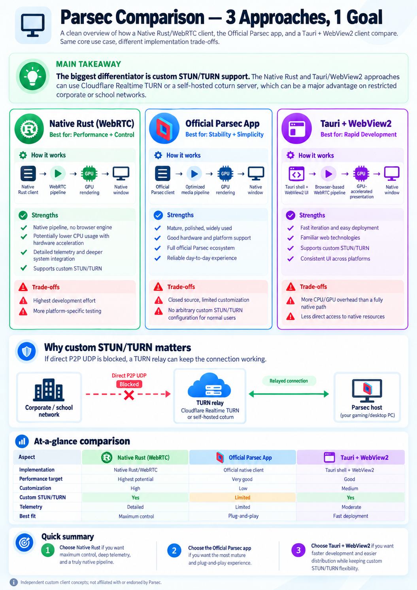

# ParsecWebTurn

**Connect to your Parsec computer with a lightweight, portable client.**

ParsecWebTurn is an independent community client for Parsec, built with Rust.
The goal is simple: smooth remote video and sound, more control over
how you connect, and support for more devices over time.

The native client runs without Edge or WebView2. It keeps Parsec's web-client core
and familiar interface, while Rust handles the connection, video, audio and input.
On Windows, you launch a single **ParsecWebTurn.exe**.

> **You are viewing the native client's development branch.** It already supports
> real remote sessions, but some features are still being built. The `main` branch
> and current stable release use the earlier Tauri/WebView2 client.
> ParsecWebTurn is not the official Parsec app and is not affiliated with Parsec or Unity.

This branch contains only the native client. The earlier WebView2 source remains
available on `main` and in the [v0.7.0 source](https://github.com/vampywiz17/ParsecWebTurn/tree/v0.7.0).

## Why this project?

- **A portable client:** one executable, with no browser runtime to install.
- **GPU-focused video:** use the graphics card for the video pipeline and aim to
  keep CPU work low.
- **More connection options:** bring custom STUN/TURN servers to the native client,
  building on the earlier WebView2 version.
- **More platforms:** work toward Linux, then explore Android and Android TV.
- **Better visibility:** useful connection and playback statistics from the
  native client itself.

These are development goals, not a promise of lower resource usage than every
other client. Performance depends on your computer, graphics driver and stream.

## What can I use today?

The native Windows development build currently supports:

- Signing in, browsing your computers and connecting to a Parsec host.
- H.264 video and optional H.265 / HEVC Main (8-bit) playback with a D3D11-based
  GPU video pipeline.
- Opus audio, keyboard and mouse input.
- The familiar Parsec stream overlay, including its relative-mouse option. The
  overlay uses software drawing for compatibility; streamed video stays on the
  existing GPU path. `--d3d-overlay` selects the previous overlay renderer for
  troubleshooting.
- Remembering your sign-in and Parsec preferences between launches.
- Graceful disconnect from the overlay and when closing the app.
- Custom STUN servers and TURN relays over UDP, TCP or TLS, including Cloudflare.
- A separate Connection stats window with live traffic, RTT, FPS, video/audio details,
  encryption status and this app's CPU/GPU usage. It identifies the active direct or
  TURN route and, when available, the relay server actually in use.
- Windows media scheduling and device-supported low-latency audio output,
  with automatic fallback for endpoints that need the standard audio path.
- A saved video GPU choice for multi-GPU systems, with Automatic as the default.

Your remote computer still needs the regular Parsec host. Not every setting in
the original interface has been integrated or tested yet.

## Getting started

1. Download **ParsecWebTurn-dev-win64** from a successful
   [native Windows build](https://github.com/vampywiz17/ParsecWebTurn/actions/workflows/native-wasm-prototype.yml?query=branch%3Adev).
   GitHub may require you to sign in to download build artifacts.
2. Unzip the package and run **ParsecWebTurn.exe**.
3. Sign in to your Parsec account and select your computer.

You need Windows x64 and compatible graphics drivers with D3D11 and OpenGL support.
There is no installer and the app does not require administrator rights to run.
Windows may separately ask about firewall access; network rules can affect whether
a connection succeeds.

**Shortcuts:** F11 switches fullscreen on or off. F8 shows or hides the video layer
if you need to reach the interface underneath. Use the Parsec overlay for stream
controls, volume and relative mouse mode.

Open **Help > Check for updates** to check for a newer stable GitHub release and
read its release notes in a native window. The app also checks once in the
background at startup and shows an available update without taking focus away
from your current window. It checks stable releases only, including when running
a dev build: `0.9.3` is newer than `0.9.3-dev.1`, while an older stable release is
never offered as a downgrade. Dev prereleases are not offered by this updater.

Choose **Download ZIP** to open the official release archive in your default
browser, then close the app and replace `ParsecWebTurn.exe` manually. Keep
`settings.json`; your saved native sign-in and preferences remain in place.
The app does not download, execute or install updates itself. Network failures
do not block startup or streaming. Set `PARSECWEBTURN_NO_UPDATE_CHECK=1` in the
environment to disable the startup check; the Help command remains available.

Open **Connection stats** or press **Ctrl+Shift+S** for native measurements in a
separate window. Unknown measurements stay unknown. Traffic shows actual usage,
not your maximum connection speed. Audio format remains visible during silence;
the host's configured audio bitrate is not exposed. Network packet loss is not
available for this client's SCTP video transport; local dropped frames are separate.
Hardware decode shows **Likely (D3D11 decoder surface)** when the decoded frame
uses a decoder-specific GPU surface. This is evidence from the actual output,
not a guarantee of hardware execution. A plain GPU surface is insufficient;
missing evidence stays **Not reported**.

Open **Settings** or press **Ctrl+,** to change servers. The Network page shows only
the fields for your selected TURN provider, with descriptions beside each setting.
Leave the STUN field empty to use Parsec's default. For LAN/VPN connections, you
can supply your own STUN server and enable **STUN only** to exclude all TURN relays.
For a custom relay, enter its TURN URL, username and password; or select Cloudflare
and enter your TURN Key ID and API token. Changes apply on the next connection.

Enable **Force TURN relay** to use TURN even when a direct route is available,
for example when a VPN's direct route gives unstable playback. This requires a
configured TURN provider and cannot be combined with STUN only. UDP TURN gets
first preference; TLS and then plain TCP are timed fallbacks if it has not
connected. Without this checkbox, ICE continues to allow direct connections.

The embedded Parsec **Hotkeys** page remains responsible for configuring and
saving stream shortcuts. Custom bindings take priority over conflicting native
shortcuts, including F8/F11. They work while the client has focus; background
global hotkeys are not implemented by this core.

**Video GPU** selects the adapter for native stream decoding and rendering;
it does not change the host or the GPU used by the embedded interface. Automatic
keeps Windows' default adapter. Choose a GPU that supports D3D11 and H.264 decoding.
If a saved GPU becomes unavailable or cannot be identified uniquely, select
Automatic or another available GPU before reconnecting. Using a different GPU
from your display can introduce driver-managed transfers on hybrid systems.

Enable **Prefer H.265 / HEVC** in Settings to advertise HEVC support on your next
connection. This needs a compatible GPU and an installed Windows HEVC decoder.
The host may still send H.264; Connection stats shows the codec actually received.

Examples: `turn:turn.example.com:3478?transport=udp`,
`turn:turn.example.com:3478?transport=tcp`, or
`turns:turn.example.com:443?transport=tcp`. The last option requires a TLS-enabled
TURN server with a trusted certificate; changing the port alone does not enable TLS.

Sign-in and preferences are saved under `%LOCALAPPDATA%\ParsecWebTurn\Native`,
encrypted for your Windows user. Replacing the EXE keeps these settings. When
moving from the older WebView2 client, sign in once in the native app; your old
settings and browser profile are left in place.

For the previous WebView2-based stable client, see
[Releases](https://github.com/vampywiz17/ParsecWebTurn/releases).

## Milestones and roadmap

**Available** means implemented in the native dev build. **Planned** means it is
not available there yet. **Exploring** means a possible future direction, with no
delivery commitment. There are no fixed release dates for these milestones.

| Milestone | Status | What it means for you |
| --- | --- | --- |
| Native Rust WebRTC client | Available | Connect to a Parsec host without WebView2, using the existing Parsec WASM core. |
| Native Windows video, audio and controls | Available | D3D11 video output, H.264 playback, Opus sound, keyboard, mouse and the Parsec overlay. |
| H.265 / HEVC playback | Available (opt-in) | Request HEVC Main (8-bit), recognize the incoming codec and decode it through Media Foundation with D3D11 GPU presentation. Verified in a live 1080p session; requires compatible GPU/decoder support. H.264 remains the default. |
| Single executable and saved settings | Available | Run the portable EXE; keep your sign-in and preferences after restarting. |
| STUN connectivity | Available | Parsec's default STUN server, custom discovery servers and a STUN-only option for LAN/VPN use. |
| Custom STUN and TURN relay support | Available | Cloudflare or custom TURN servers, including UDP, TCP and TLS server connections. Compatible with the earlier client's server settings file. |
| More audio formats and menu integration | Planned | Support additional audio choices and review which Parsec settings need native integration. |
| Native connection and playback statistics | Available | Separate native stats window: active direct/TURN route, relay server, RTT, traffic, decoded FPS, video/audio details, DTLS state and app CPU/GPU usage. Missing data stays unknown. |
| Vulkan rendering backend | Planned | Add another GPU rendering option alongside D3D11 and build toward Linux support. |
| D3D12 rendering backend | Exploring | Investigate an additional native GPU rendering option on Windows. |
| Linux client, distributed as Flatpak | Planned | Make the native client available on Linux with straightforward installation. |
| Native Android and Android TV clients | Exploring | Investigate a mobile/TV client using the shared Rust foundation and a Vulkan rendering path. |

Vulkan is one part of bringing the client to other platforms. Linux and Android
also need their own video decoding, audio, window and input integration; adding
Vulkan alone will not make the Windows client run there.

## The Parsec core, beyond the browser

Although our Parsec core comes from the web client, it runs here inside a native
Rust application, using an embedded WebAssembly runtime and a precompiled core.
It does not need a browser or WebView2. Rust supplies the surrounding connection,
video decoding, sound and input support. Our investigation points to shared
native foundations with Parsec's official client and SDK, rather than an entirely
separate browser-only implementation. That does not establish that their code
or feature sets are identical.

WebRTC acts as the **transport** in this client. Video, audio and control messages
travel through WebRTC data channels using Parsec's own application protocol;
they do not use the usual WebRTC audio/video track and RTP playback pipeline.
The WebRTC connection itself still uses standard ICE, DTLS and SCTP mechanisms.

This lets us rebuild the surrounding client in Rust while retaining the Parsec
core and host compatibility. We can control native decoding and rendering,
including the working HEVC path, while keeping WebRTC's connection options:
direct routes, custom STUN discovery and TURN relays over UDP, TCP or TLS.
We reuse the core rather than rewriting it, and build our own native integration
around it.

## STUN, TURN and restricted networks

**STUN helps find a direct connection. TURN forwards traffic when a direct route
is unavailable.** This can be useful on restrictive networks or computers where
installing a VPN is not possible.

The native dev client configures its Rust WebRTC transport directly. No browser
or JavaScript injection is involved. It reads the earlier client's `settings.json`
beside the executable, preserving its fields and Windows-protected credentials.
To use a different writable directory, launch with `--data-dir "C:\YourFolder"`.
Your Parsec sign-in profile remains in its separate location described above.

TURN is an alternative route offered to ICE, and may be selected even when a
direct route is possible. **STUN only** prevents this by excluding TURN entirely.
With that option enabled, Cloudflare credentials are not requested or required.

The goal is to offer direct connections and user-chosen relays without requiring
a VPN or Parsec's paid relay offering. Your relay provider may still charge for
traffic. A relay also needs to be reachable and permitted by the network; no
client can guarantee access through every company or school firewall.

## Three approaches, one goal

The illustration below compares the native Rust direction, the official Parsec
app and the earlier Tauri/WebView2 approach.

> **Concept illustration:** it includes planned features and potential benefits.
> In particular, Vulkan and broader platform support are not present in this
> dev build. Use the roadmap above
> for the current status. The image is not a benchmark or an up-to-date reference
> for the official app's features or pricing.

[Open the full-size comparison](assets/native-client-comparison-v2.png).

## Help improve the client

Found a problem? [Open an issue](https://github.com/vampywiz17/ParsecWebTurn/issues)
with your app version, Windows version, graphics card and the steps to reproduce
it. Say whether you are connecting directly, through a VPN or using the earlier
WebView2 client's relay options. Never include passwords, session tokens or TURN
credentials in a public report.

For implementation, build instructions and host-certificate compatibility details,
see the [technical guide](docs/NATIVE_TECHNICAL.md). The
[configuration compatibility notes](docs/NATIVE_CONFIG_COMPATIBILITY.md) describe
compatibility of old STUN/TURN settings, and the
[validation history](docs/NATIVE_DEV_0_8.md) records what has been tested.

Parsec and its client core belong to their respective owners. ParsecWebTurn is an
independent project; included third-party license notices must accompany binary
redistribution.
