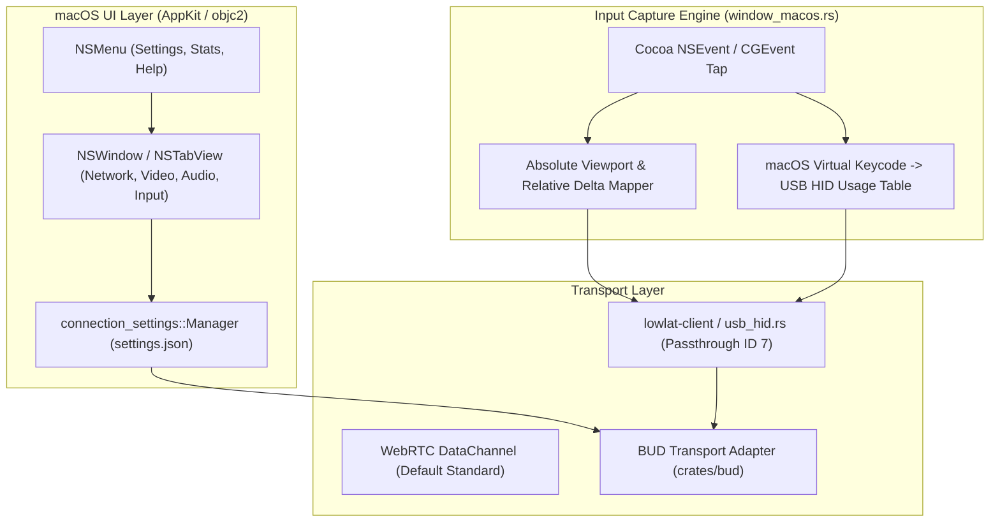

# macOS Native Settings UI and Experimental BUD USB HID Input

Dokumen spesifikasi teknis dan panduan implementasi untuk agen/developer dalam mengintegrasikan:
1. **Native macOS Settings Menu & UI** (`NSMenu` dan Settings Window Cocoa/AppKit).
2. **Porting Transport BUD & USB HID Input (Mouse & Keyboard)** ke macOS (`aarch64-apple-darwin`).

---

## 1. Latar Belakang & Akar Masalah

Pada versi Windows, pengguna dapat mengonfigurasi opsi:
- `[✓] USB HID mouse (experimental, BUD)`
- `[✓] USB HID keyboard (experimental, BUD)`

Opsi ini berada di dalam **Settings Window > Tab "Input"**. Namun pada macOS saat ini:
1. **Settings UI masih 100% Win32**: File `src-native/src/connection_settings_ui.rs` dibuat menggunakan Win32 Native API (`HWND`, `CreateWindowExW`, `SendMessageW`, Win32 GDI brushes). Pada `window_macos.rs`, belum ada implementasi `NSMenu` bar dan jendela pengaturan berbasis Cocoa/AppKit.
2. **Fitur BUD Dibatasi Khusus Windows di `Cargo.toml`**:
   ```toml
   [target.'cfg(windows)'.dependencies]
   parsec-native-bud = { path = "crates/bud", optional = true }
   ```
   Akibatnya, flag `#[cfg(feature = "bud")]` tidak aktif pada build macOS, dan struct `Settings` di `connection_settings.rs` mengabaikan field `experimental_hid_mouse` dan `experimental_hid_keyboard`.

---

## 2. Prinsip & Batasan Standar (Sesuai `AGENTS.md`)

Setiap agen yang mengimplementasikan fitur ini **WAJIB** mematuhi batasan berikut:
- **WebRTC Tetap Default**: Transport WebRTC standar tidak boleh terganggu. BUD hanya aktif jika pengguna secara eksplisit mengaktifkan opsi BUD di `settings.json`.
- **Kegagalan BUD Tidak Boleh Merusak WebRTC**: Jika koneksi BUD gagal, sistem tidak boleh secara diam-diam mengubah status konfigurasi atau merusak fallback WebRTC TURN/TCP/TLS.
- **Gunakan API Resmi macOS**: Gunakan Cocoa/AppKit melalui crate `objc2`, `objc2-app-kit`, `objc2-foundation`, dan CoreGraphics (`CGEvent` / `CGAssociateMouseAndMouseCursorPosition`). Dilarang menggunakan private API atau hook yang memerlukan hak akses Administrator/root.
- **Isolasi Siklus Hidup USB HID**: Perangkat USB virtual yang diumumkan ke host Parsec harus mengikuti siklus hidup bersama (satu device manager di endpoint `0x81`), tanpa memalsukan interupsi atau ACK palsu.

---

## 3. Arsitektur Komponen



---

## 4. Rencana Implementasi Langkah demi Langkah

### Bagian A: Mengaktifkan BUD & USB HID Crate di macOS

#### Langkah 1: Perbarui `src-native/Cargo.toml`
Ubah dependensi `parsec-native-bud` dari Windows-only menjadi multi-platform:
```toml
# Ganti dari:
# [target.'cfg(windows)'.dependencies]
# parsec-native-bud = { path = "crates/bud", optional = true }

# Menjadi:
[target.'cfg(any(windows, target_os = "macos"))'.dependencies]
parsec-native-bud = { path = "crates/bud", optional = true }
```
Fitur `bud` sudah termasuk default, jadi aktif di macOS tanpa flag tambahan.

#### Langkah 2: Audit & Sesuaikan Guard `cfg` di Backend
Perbarui guard bersyarat di file-file berikut dari `#[cfg(all(windows, feature = "bud"))]` menjadi `#[cfg(all(any(windows, target_os = "macos"), feature = "bud"))]`:
- `src-native/src/backend.rs` (inisialisasi `bud_attempt` dan dispatch kontrol)
- `src-native/src/control.rs` (framing opcode kontrol BUD)
- `src-native/src/websocket.rs` (alokasi signaling session BUD)
- `src-native/src/main.rs` dan `src-native/src/host.rs`

---

### Bagian B: Implementasi Menu & Jendela Settings Native macOS

#### Langkah 3: Bilah Menu macOS (`NSMenu`)
Di `src-native/src/window_macos.rs`, tambahkan konstruksi bilah menu aplikasi standar macOS:
1. **Menu Bar Utama**:
   - **ParsecWebTurn** (App Menu): `About`, `Check for Updates`, `Preferences...` (`Cmd+,`), `Quit` (`Cmd+Q`).
   - **View / Session**: `Connection Stats` (`Cmd+I`), `Toggle Fullscreen` (`Cmd+F`).
2. Sambungkan aksi `Preferences...` untuk membuka jendela Settings.

#### Langkah 4: Jendela Pengaturan (`Settings Window`)
Buat modul baru `src-native/src/connection_settings_ui_macos.rs`:
1. Buat `NSWindow` terpisah dengan `NSTabView` yang memiliki 4 tab identik dengan Windows:
   - **Network**: Client ICE, Force TURN, Bandwidth limit, checkbox `BUD transport` (pilihan eksplisit; opsi HID nonaktif selama BUD mati, sama seperti Windows).
   - **TURN**: STUN servers, provider (Custom servers / Cloudflare TURN) dengan field kredensial yang sama seperti halaman Network Windows. URL dipisah spasi; password/token dikosongkan = pakai yang tersimpan, dan tidak pernah ditampilkan kembali.
   - **Video**: Prefer HEVC, 10-bit color, Presentation mode.
   - **Audio**: Custom audio buffer, Raw audio.
   - **Input**:
     - Checkbox: `USB HID mouse (experimental, BUD)`
     - Checkbox: `USB HID keyboard (experimental, BUD)`
     - Keterangan teks passthrough dan kompatibilitas tata letak keyboard.
2. Hubungkan checkbox dengan `connection_settings::Manager`:
   - Saat dicentang/diubah, perbarui struct `Settings` (`experimental_hid_mouse = true/false`, `experimental_hid_keyboard = true/false`). `bud` hanya diambil dari checkbox BUD; mencentang HID tidak pernah menyalakan BUD.
   - Simpan perubahan ke `settings.json`.

---

### Bagian C: Mesin Input Capture USB HID macOS

#### Langkah 5: Penangkapan Mouse USB HID (`usb_hid.rs` + `window_macos.rs`)
1. **Mode Desktop Absolut**:
   - Tangkap koordinat kursor lokal dari `NSEvent` (`locationInWindow`).
   - Normalisasikan terhadap viewport video aktif (`presented_viewport()`):
     $$\text{HID}_X = \text{clamp}\left(\frac{x - \text{vp}_x}{\text{vp}_w} \times 32767, 0, 32767\right)$$
     $$\text{HID}_Y = \text{clamp}\left(\frac{y - \text{vp}_y}{\text{vp}_h} \times 32767, 0, 32767\right)$$
   - Format paket laporan HID Mouse: 5 tombol (Left, Right, Middle, Back, Forward) + Posisi Absolut X/Y + Scroll delta.
2. **Mode Kamera Relatif**:
   - Ketika host meminta mode relatif / menyembunyikan kursor (`cursor.relative || cursor.hidden`):
     - Panggil `CGAssociateMouseAndMouseCursorPosition(false)` untuk mengunci kursor dan menyembunyikannya.
     - Baca delta mentah melalui `event.deltaX()` dan `event.deltaY()`.
     - Kirim laporan delta USB HID ke host.
   - Saat keluar dari mode relatif:
     - Panggil `CGAssociateMouseAndMouseCursorPosition(true)` dan kembalikan kursor ke posisi desktop semula.

#### Langkah 6: Pemetaan Keyboard USB HID (`mac_key_to_hid_usage`)
Di `src-native/src/window_macos.rs`, buat tabel konversi dari macOS virtual keycode (kVK) ke standar **USB HID Usage Tables (Page 0x07 - Keyboard/Keypad)**:

| Tombol | macOS Virtual Keycode | USB HID Usage ID | Catatan |
|---|---|---|---|
| Key A - Z | `0x00` - `0x0B`, dll. | `0x04` - `0x1D` | Mengikuti fisik tombol ANSI/ISO |
| Digit 1 - 0 | `0x12` - `0x1D` | `0x1E` - `0x27` | Baris angka utama |
| Return / Enter | `0x24` | `0x28` | |
| Escape | `0x35` | `0x29` | |
| Backspace | `0x33` | `0x2A` | |
| Tab | `0x30` | `0x2B` | |
| Spacebar | `0x31` | `0x2C` | |
| Left Control | `0x3B` | `0xE0` | Modifier bit 0 |
| Left Shift | `0x38` | `0xE1` | Modifier bit 1 |
| Left Option/Alt | `0x3A` | `0xE2` | Modifier bit 2 |
| Left Command (GUI) | `0x37` | `0xE3` | Modifier bit 3 |
| Right Control | `0x3E` | `0xE4` | Modifier bit 4 |
| Right Shift | `0x3C` | `0xE5` | Modifier bit 5 |
| Right Option/Alt | `0x3D` | `0xE6` | Modifier bit 6 |
| Right Command (GUI) | `0x36` | `0xE7` | Modifier bit 7 |

*Aturan Input Keyboard USB HID*:
- Kirim laporan berupa bitmap key state penuh (tidak dibatasi protokol BIOS 6-key rollover).
- Sinkronisasi modifier dilakukan secara deterministik saat event `NSEventType::FlagsChanged`.
- Saat jendela kehilangan fokus (`Event::Focus(false)`), kirim paket rilis kosong (`Event::HidInputRelease`) untuk mencegah tombol tertahan (stuck keys).

---

## 5. Pengujian & Verifikasi (Test Suite)

Agen yang mengeksekusi harus memverifikasi implementasi dengan skenario berikut:

1. **Uji Konfigurasi JSON (`connection_settings.rs`)**:
   - Jalankan `cargo test connection_settings`.
   - Pastikan serialisasi dan deserialisasi `settings.json` memuat `experimentalHidMouse` dan `experimentalHidKeyboard` tanpa error.
2. **Uji Isolasi Transport (AGENTS.md Compliance)**:
   - Pastikan flag `bud: false` tetap menjalankan WebRTC default secara penuh tanpa memanggil inisialisasi USB HID.
   - Pastikan seluruh 207 pengujian unit yang ada tetap lulus (`cargo test --tests`).
3. **Uji Siklus Hidup USB HID**:
   - Uji penanganan hilangnya fokus: saat jendela diminimalkan atau beralih aplikasi, pastikan rilis tombol terkirim dan kursor tidak terkunci di luar jendela.

---

## Video macOS (`video_macos.rs`)

- Paket Annex B H.264/HEVC diubah menjadi `CMSampleBuffer` (NAL berawalan panjang 4 byte; VPS/SPS/PPS masuk `CMVideoFormatDescription`, dibuat ulang saat parameter set berubah) lalu di-enqueue ke `AVSampleBufferDisplayLayer` dengan `DisplayImmediately`.
- Layer itulah yang men-decode (VideoToolbox) dan menampilkan lewat Core Animation; tidak ada readback CPU di klien. Layer tidak melaporkan apakah decoder hardware dipakai, jadi `hardware_decode` tetap tidak diketahui, dan tidak ada klaim zero-copy.
- View video berada di atas `NSOpenGLView`; view GL disembunyikan selama video tampil (seperti surface video Windows yang menutupi GL). Overlay UI Parsec di atas video belum ada di macOS.
- HEVC hanya ditawarkan bila `VTIsHardwareDecodeSupported('hvc1')`. HEVC 10-bit belum ditawarkan karena dukungannya tidak bisa ditanyakan tanpa decode percobaan.
- Status layer `failed` → `flush`, tunggu IDR, minta keyframe lewat mekanisme recovery `video_output::Queue` yang sama dengan Windows.
- Test (`cargo test video_macos`): fixture H.264 1080p dan HEVC Main10 720p di-decode lewat `VTDecompressionSession` dari sample buffer yang sama, dan pesan ke layer diuji langsung.

---

## 6. Referensi Kode Terkait
- [usb_hid.rs](file:///Users/eleonorez/Documents/project/ParsecWebTurn/src-native/crates/bud/vendor/lowlat-client/src/usb_hid.rs): Definisi deskriptor USB HID dan pembuatan paket laporan.
- [connection_settings_ui.rs](file:///Users/eleonorez/Documents/project/ParsecWebTurn/src-native/src/connection_settings_ui.rs): Referensi tata letak opsi Windows asli.
- [connection_settings.rs](file:///Users/eleonorez/Documents/project/ParsecWebTurn/src-native/src/connection_settings.rs): Struktur data `Settings` dan pembacaan `settings.json`.
- [window_macos.rs](file:///Users/eleonorez/Documents/project/ParsecWebTurn/src-native/src/window_macos.rs): Implementasi jendela AppKit Cocoa dan penanganan event macOS.
- [usb-hid-input.md](file:///Users/eleonorez/Documents/project/ParsecWebTurn/docs/usb-hid-input.md): Dokumentasi spesifikasi perilaku mouse/keyboard BUD.
